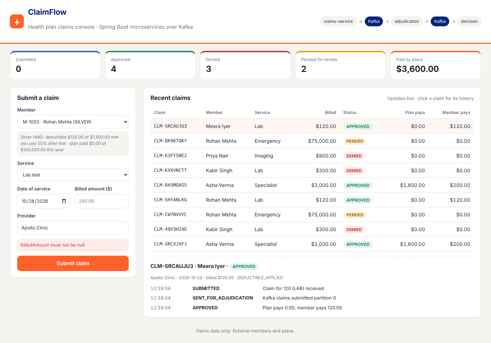

# ClaimFlow

Event-driven health-insurance claims processing, built with two Spring Boot microservices that talk over
Kafka. A claim is submitted through a REST API or the web console. It is checked against the member's plan
(coverage dates, covered services, deductible, coinsurance, annual maximum) and then approved, denied or
pended for manual review. Every step is recorded in a timeline that you can audit.



## Architecture

```
 web console / REST client
          │  POST /api/claims
          ▼
 ┌──────────────────────┐   claims.submitted    ┌───────────────────────────┐
 │    claims-service    │ ────────────────────> │   adjudication-service    │
 │  (port 8081)         │                       │   (port 8082)             │
 │  MySQL: plans,       │ <──────────────────── │   benefit rules engine    │
 │  members, claims     │   claims.adjudicated  │   retries, then           │
 │  MongoDB: timeline   │                       │   claims.submitted.DLT    │
 └──────────────────────┘                       └───────────────────────────┘
          │ logs (JSON over HTTP Event Collector)
          ▼
        Splunk (optional profile)
```

- **claims-service** owns the data. The relational data (plans, members, claims) is in **MySQL**, with the
  schema and seed data managed by **Flyway**. The claim timeline (an append-only event history) is in
  **MongoDB**.
- A claim is published to Kafka only **after the database transaction commits**
  (`@TransactionalEventListener(AFTER_COMMIT)`), so a rolled-back claim is never adjudicated.
- **adjudication-service** is stateless. It consumes `claims.submitted`, applies the rules and publishes
  `claims.adjudicated`. Failed messages are retried 3 times and then sent to a dead-letter topic.
- Applying a decision is **idempotent**: a duplicate or replayed decision for a claim that is already final
  is ignored. Member accumulators use **optimistic locking** (`@Version`).
- Errors are returned as RFC 7807 `ProblemDetail` responses, with readable validation messages.

## Benefit rules

Rules are checked in order. The first rule that matches decides the claim.

| Rule | Result | Reason code |
| --- | --- | --- |
| Service date outside the member's coverage | DENIED | `COVERAGE_INACTIVE` |
| Service type not covered by the plan | DENIED | `SERVICE_NOT_COVERED` |
| Billed amount ≥ review threshold (50,000) | PENDED | `MANUAL_REVIEW` |
| Otherwise | APPROVED | `DEDUCTIBLE_APPLIED`, `ANNUAL_MAX_REACHED` when relevant |

For an approved claim, the remaining deductible is paid by the member first. The plan pays
`(100 − coinsurance)%` of the rest, capped at what is left of the annual maximum. Money uses 2 decimal places,
rounded half-up.

Seeded plans: **GOLD** (500 deductible, 10% coinsurance, all services), **SILVER** (1,500, 20%, no imaging) and
**BASIC** (3,000, 30%; primary care, lab and emergency only). Five demo members cover the main cases, for
example M-1004, whose coverage ended in 2025.

## Run it

**Full stack with Docker** (MySQL, MongoDB, Kafka and both services):

```bash
docker compose up --build
# console: http://localhost:8081
```

**With Splunk** as well (local only; see [docs/splunk.md](docs/splunk.md)):

```bash
docker compose --profile splunk up --build
# Splunk: http://localhost:8000  (admin / see docs/splunk.md)
```

**Tests** (Java 21, Maven):

```bash
mvn verify                    # JUnit: 32 tests, no Docker needed (embedded Kafka, H2)
mvn verify -Pe2e              # + 4 Selenium tests in headless Chrome
```

## API

| Method | Path | Description |
| --- | --- | --- |
| GET | `/api/plans` | plans and their benefits |
| GET | `/api/members`, `/api/members/{memberNumber}` | members with deductible and benefits used |
| POST | `/api/claims` | submit a claim. Returns `202 Accepted` with a `Location` header |
| GET | `/api/claims?memberNumber=` | list claims, newest first |
| GET | `/api/claims/{id}` | a claim with its full timeline |
| GET | `/api/summary` | count and amounts by status |

```bash
curl -X POST localhost:8081/api/claims -H 'Content-Type: application/json' -d '{
  "memberNumber": "M-1001", "serviceType": "SPECIALIST", "serviceDate": "2026-03-15",
  "providerName": "Apollo Clinic", "billedAmount": 2000 }'
```

## Tests

| Suite | Type | What it checks |
| --- | --- | --- |
| `AdjudicationEngineTest` (18) | JUnit 5, parameterized | every rule, deductible and annual-max edge cases, rounding |
| `ClaimListenerKafkaTest` (1) | embedded Kafka | consume → decide → publish |
| `SplunkHecAppenderTest` (3) | fake HEC server | event format, auth header, batching |
| `ClaimsApiTest` (6) | MockMvc + Kafka | validation, 404s, event published after commit |
| `FullFlowTest` (4) | both services + Kafka | approved, denied (coverage, service), pended |
| `ClaimsUiSeleniumTest` (4) | Selenium, headless Chrome | submit through the console and see the decision |

CI (GitHub Actions) runs three jobs on every push: build with JUnit, Selenium in headless Chrome, and a Docker
Compose smoke test against real MySQL, MongoDB and Kafka.

## Project layout

```
claim-events/           shared event records, enums, topic names, Splunk HEC Logback appender
adjudication-service/   Kafka consumer + rules engine + dead-letter handling
claims-service/         REST API, JPA + Flyway (MySQL), MongoDB timeline, web console, Selenium tests
docker-compose.yml      mysql, mongo, kafka (KRaft), both services, splunk (profile)
.github/workflows/ci.yml
docs/kanban.md          how the work was planned on a Kanban board
docs/splunk.md          sending logs to Splunk and example searches
```

## Planning

The work was tracked on a GitHub Projects Kanban board (Backlog → Ready → In progress → Review → Done, with a
WIP limit of 2). See [docs/kanban.md](docs/kanban.md).

## Use of AI tools

This project was built with help from an AI assistant (Claude, by Anthropic), used for code generation, test
writing and documentation. All code was built and tested, and the test suites above run in CI on every push.
